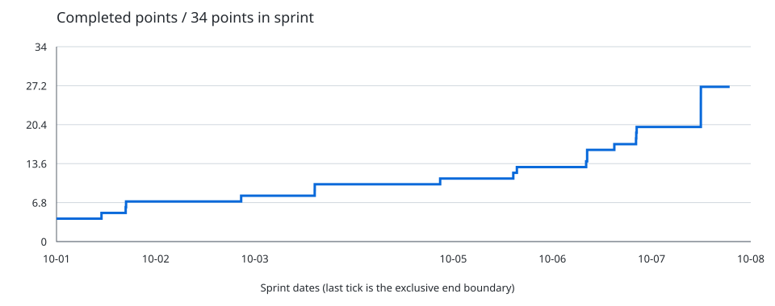

# Sprint metrics — 2026-10-07

Project: [The Arcade: Fall 2026](https://github.com/orgs/CAHSI-Game-Studios/projects/3)

Snapshot: 2026-10-07T22:53:10.453033+00:00 · Calendar timezone: America/La_Paz.

Collaborator tables include members of `the-arcade-collaborator` and its child teams.

## Daily check-in

[Join today's discussion](https://github.com/CAHSI-Game-Studios/TheArcade/discussions/89)

### Worked on yesterday
- ...

### Blockers
- None / describe the blocker and help needed.

### Planned for today
- ...

## Sprint 1

2026-10-01 through 2026-10-07 (inclusive).

### Sprint velocity (completed points burn-up)

**27 / 34 points complete**.

**24 / 31 issues complete**; 20 closed as completed during this sprint.

The y-axis maximum is the sum of Size points for all issues in this sprint. The line adds each completed issue's points once, regardless of its assignees. The x-axis spans the full sprint; the line stops at snapshot time. Earlier completions form the starting baseline.

| Date | Completed points as of this snapshot |
| --- | ---: |
| 2026-10-01 | 7 |
| 2026-10-02 | 8 |
| 2026-10-03 | 10 |
| 2026-10-04 | 11 |
| 2026-10-05 | 13 |
| 2026-10-06 | 20 |
| 2026-10-07 | 27 |

### Completed points by collaborator

Producer team members are excluded. Points are split equally among all current assignees; shares belonging to excluded people are not redistributed.

| Collaborator | Points closed during sprint |
| --- | ---: |
| @julianlaracuente | 3.00 |
| @nataliavera6 | 3.00 |
| @KennethSepu1 | 2.00 |
| @JaimyleeFP | 1.00 |
| @Kemuel05 | 1.00 |
| @nathaliecstro | 1.00 |
| @patricia-merced04 | 1.00 |
| @SebastianRivera58 | 1.00 |
| @ShiningStarlight01 | 1.00 |
| @TekmethDelta | 1.00 |
| @Yadriel-Zavala | 1.00 |
| @yadzielperez09 | 1.00 |
| @yamilette-alemany | 1.00 |
| @Andres-Rivera-Nieves | 0.00 |
| @JavierAguilo090 | 0.00 |
| @Jomarys-Ace | 0.00 |
| @RBN025 | 0.00 |
| @Ricar01212 | 0.00 |
| @seb-rv | 0.00 |

Points not credited to listed collaborators: **5.00** (unassigned issues, Producers, or people outside the collaborator team).

### Sprint issue audit

| Issue | State | Size points | Assignees | Latest close |
| --- | --- | ---: | --- | --- |
| [CAHSI-Game-Studios/TheArcade#17 julianlaracuente OC description  ](https://github.com/CAHSI-Game-Studios/TheArcade/issues/17) | COMPLETED | 1 | @julianlaracuente | 2026-10-05T00:50:01Z |
| [CAHSI-Game-Studios/TheArcade#18 @SebastianRivera58 OC description](https://github.com/CAHSI-Game-Studios/TheArcade/issues/18) | COMPLETED | 1 | @SebastianRivera58 | 2026-10-07T00:23:23Z |
| [CAHSI-Game-Studios/TheArcade#19 JavierAguilo090 OC description](https://github.com/CAHSI-Game-Studios/TheArcade/issues/19) | COMPLETED | 1 | @JavierAguilo090 | 2026-09-27T23:31:10Z |
| [CAHSI-Game-Studios/TheArcade#2 nu-hazd OC description](https://github.com/CAHSI-Game-Studios/TheArcade/issues/2) | COMPLETED | 1 | @nu-hazd | 2026-10-01T14:53:02Z |
| [CAHSI-Game-Studios/TheArcade#20 Find an open source/royalte free sprite creator](https://github.com/CAHSI-Game-Studios/TheArcade/issues/20) | OPEN | 1 | @Yadriel-Zavala | — |
| [CAHSI-Game-Studios/TheArcade#21 Find an open source/royalty free music composition tool](https://github.com/CAHSI-Game-Studios/TheArcade/issues/21) | OPEN | 1 | @Yadriel-Zavala | — |
| [CAHSI-Game-Studios/TheArcade#22 Andres-Rivera-Nieves OC](https://github.com/CAHSI-Game-Studios/TheArcade/issues/22) | OPEN | 1 | @Andres-Rivera-Nieves | — |
| [CAHSI-Game-Studios/TheArcade#23 @nataliavera6 OC description](https://github.com/CAHSI-Game-Studios/TheArcade/issues/23) | COMPLETED | 1 | @nataliavera6 | 2026-10-05T19:24:04Z |
| [CAHSI-Game-Studios/TheArcade#24 @TekmethDelta OC creation](https://github.com/CAHSI-Game-Studios/TheArcade/issues/24) | COMPLETED | 1 | @TekmethDelta | 2026-10-01T20:49:50Z |
| [CAHSI-Game-Studios/TheArcade#25 @nathaliecstro OC creation](https://github.com/CAHSI-Game-Studios/TheArcade/issues/25) | COMPLETED | 1 | @nathaliecstro | 2026-10-06T18:58:42Z |
| [CAHSI-Game-Studios/TheArcade#27 Ricar01212 OC description](https://github.com/CAHSI-Game-Studios/TheArcade/issues/27) | COMPLETED | 1 | @Ricar01212 | 2026-09-27T23:33:35Z |
| [CAHSI-Game-Studios/TheArcade#29 Set Up Godot Project and Basic Folder Structure](https://github.com/CAHSI-Game-Studios/TheArcade/issues/29) | COMPLETED | 1 | @nataliavera6 | 2026-09-27T23:34:48Z |
| [CAHSI-Game-Studios/TheArcade#32 @Jomarys-Ace OC Description](https://github.com/CAHSI-Game-Studios/TheArcade/issues/32) | OPEN | 1 | @Jomarys-Ace | — |
| [CAHSI-Game-Studios/TheArcade#33 Configure Godot Project Settings](https://github.com/CAHSI-Game-Studios/TheArcade/issues/33) | COMPLETED | 1 | @yamilette-alemany | 2026-09-30T17:48:09Z |
| [CAHSI-Game-Studios/TheArcade#34 Set Up Hubworld Temp Player Scene](https://github.com/CAHSI-Game-Studios/TheArcade/issues/34) | COMPLETED | 1 | @KennethSepu1 | 2026-10-01T20:44:14Z |
| [CAHSI-Game-Studios/TheArcade#36 Create Start Screen](https://github.com/CAHSI-Game-Studios/TheArcade/issues/36) | OPEN | 1 | @RBN025 | — |
| [CAHSI-Game-Studios/TheArcade#39 @JaimyleeFP OC Description](https://github.com/CAHSI-Game-Studios/TheArcade/issues/39) | COMPLETED | 1 | @JaimyleeFP | 2026-10-03T18:28:42Z |
| [CAHSI-Game-Studios/TheArcade#4 Domain: Gameplay Loop](https://github.com/CAHSI-Game-Studios/TheArcade/issues/4) | COMPLETED | 2 | @nu-hazd | 2026-10-07T15:54:59Z |
| [CAHSI-Game-Studios/TheArcade#42 @FabiolaZTorres OC description](https://github.com/CAHSI-Game-Studios/TheArcade/issues/42) | COMPLETED | 1 | @FabiolaZTorres | 2026-10-06T12:09:48Z |
| [CAHSI-Game-Studios/TheArcade#43 @yadzielperez09 OC description](https://github.com/CAHSI-Game-Studios/TheArcade/issues/43) | COMPLETED | 1 | @yadzielperez09 | 2026-10-07T15:55:10Z |
| [CAHSI-Game-Studios/TheArcade#44 @KennethSepu1 OC description](https://github.com/CAHSI-Game-Studios/TheArcade/issues/44) | COMPLETED | 1 | @KennethSepu1 | 2026-10-05T18:31:51Z |
| [CAHSI-Game-Studios/TheArcade#45 @yamilette-alemany OC description](https://github.com/CAHSI-Game-Studios/TheArcade/issues/45) | COMPLETED | 1 | @yamilette-alemany | 2026-10-07T00:13:55Z |
| [CAHSI-Game-Studios/TheArcade#46 @Miguel-Maldonado10 OC description](https://github.com/CAHSI-Game-Studios/TheArcade/issues/46) | OPEN | 1 | @Miguel-Maldonado10 | — |
| [CAHSI-Game-Studios/TheArcade#47 @kamila-rod1114 OC description](https://github.com/CAHSI-Game-Studios/TheArcade/issues/47) | COMPLETED | 1 | @kamila-rod1114 | 2026-10-03T00:40:51Z |
| [CAHSI-Game-Studios/TheArcade#48 @Kemuel05 OC description](https://github.com/CAHSI-Game-Studios/TheArcade/issues/48) | COMPLETED | 1 | @Kemuel05 | 2026-10-07T00:17:21Z |
| [CAHSI-Game-Studios/TheArcade#49 @Yadriel-Zavala OC description](https://github.com/CAHSI-Game-Studios/TheArcade/issues/49) | COMPLETED | 1 | @Yadriel-Zavala | 2026-10-07T15:55:40Z |
| [CAHSI-Game-Studios/TheArcade#5 Domain: DialogueSystem](https://github.com/CAHSI-Game-Studios/TheArcade/issues/5) | COMPLETED | 2 | @nataliavera6 | 2026-10-06T12:24:08Z |
| [CAHSI-Game-Studios/TheArcade#51 @RBN025 OC description](https://github.com/CAHSI-Game-Studios/TheArcade/issues/51) | OPEN | 1 | @RBN025 | — |
| [CAHSI-Game-Studios/TheArcade#53 @ShiningStarlight01 OC description](https://github.com/CAHSI-Game-Studios/TheArcade/issues/53) | COMPLETED | 1 | @ShiningStarlight01 | 2026-10-07T15:55:23Z |
| [CAHSI-Game-Studios/TheArcade#62 @patricia-merced04 OC description](https://github.com/CAHSI-Game-Studios/TheArcade/issues/62) | COMPLETED | 1 | @patricia-merced04 | 2026-10-03T18:29:31Z |
| [CAHSI-Game-Studios/TheArcade#7 Domain:  HubWorld](https://github.com/CAHSI-Game-Studios/TheArcade/issues/7) | COMPLETED | 2 | @julianlaracuente | 2026-10-07T15:54:50Z |

Unestimated issues count toward issue totals and contribute no points. Only issues closed as COMPLETED earn points; NOT_PLANNED and reopened issues do not. Scope, sizes and assignees reflect the current project. Historical chart values are reconstructed from currently completed issues and their latest close times; previous daily reports preserve earlier snapshots.

## Participation in the 2026-10-06 daily check-in

No daily check-in was found for the previous calendar day. N/A means there was no discussion to measure.

| Collaborator | Participations |
| --- | ---: |
| @Andres-Rivera-Nieves | N/A |
| @FabiolaZTorres | N/A |
| @JaimyleeFP | N/A |
| @JavierAguilo090 | N/A |
| @Jomarys-Ace | N/A |
| @julianlaracuente | N/A |
| @kamila-rod1114 | N/A |
| @Kemuel05 | N/A |
| @KennethSepu1 | N/A |
| @Miguel-Maldonado10 | N/A |
| @nataliavera6 | N/A |
| @nathaliecstro | N/A |
| @nu-hazd | N/A |
| @patricia-merced04 | N/A |
| @RBN025 | N/A |
| @Ricar01212 | N/A |
| @seb-rv | N/A |
| @SebastianRivera58 | N/A |
| @ShiningStarlight01 | N/A |
| @TekmethDelta | N/A |
| @Yadriel-Zavala | N/A |
| @yadzielperez09 | N/A |
| @yamilette-alemany | N/A |
