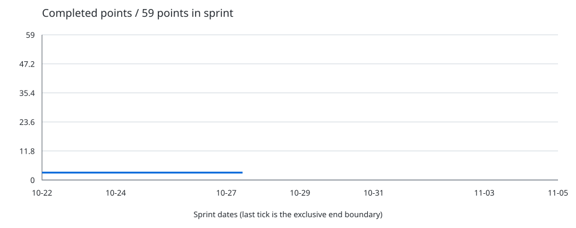

# Sprint metrics — 2026-10-27

Project: [The Arcade: Fall 2026](https://github.com/orgs/CAHSI-Game-Studios/projects/3)

Snapshot: 2026-10-27T14:36:54.700902+00:00 · Calendar timezone: America/La_Paz.

Collaborator tables include members of `the-arcade-collaborator` and its child teams.

## Daily check-in

[Join today's discussion](https://github.com/CAHSI-Game-Studios/TheArcade/discussions/131)

### Worked on yesterday
- ...

### Blockers
- None / describe the blocker and help needed.

### Planned for today
- ...

## Sprint 2

2026-10-22 through 2026-11-04 (inclusive).

### Sprint velocity (completed points burn-up)

**3 / 59 points complete**.

**1 / 24 issues complete**; 0 closed as completed during this sprint.

The y-axis maximum is the sum of Size points for all issues in this sprint. The line adds each completed issue's points once, regardless of its assignees. The x-axis spans the full sprint; the line stops at snapshot time. Earlier completions form the starting baseline.

| Date | Completed points as of this snapshot |
| --- | ---: |
| 2026-10-22 | 3 |
| 2026-10-23 | 3 |
| 2026-10-24 | 3 |
| 2026-10-25 | 3 |
| 2026-10-26 | 3 |
| 2026-10-27 | 3 |

### Completed points by collaborator

Producer team members are excluded. Points are split equally among all current assignees; shares belonging to excluded people are not redistributed.

| Collaborator | Points closed during sprint |
| --- | ---: |
| @Andres-Rivera-Nieves | 0.00 |
| @JaimyleeFP | 0.00 |
| @JavierAguilo090 | 0.00 |
| @Jomarys-Ace | 0.00 |
| @julianlaracuente | 0.00 |
| @Kemuel05 | 0.00 |
| @KennethSepu1 | 0.00 |
| @nataliavera6 | 0.00 |
| @nathaliecstro | 0.00 |
| @patricia-merced04 | 0.00 |
| @RBN025 | 0.00 |
| @Ricar01212 | 0.00 |
| @seb-rv | 0.00 |
| @SebastianRivera58 | 0.00 |
| @shamblesquasher | 0.00 |
| @ShiningStarlight01 | 0.00 |
| @TekmethDelta | 0.00 |
| @Yadriel-Zavala | 0.00 |
| @yadzielperez09 | 0.00 |
| @yamilette-alemany | 0.00 |

Points not credited to listed collaborators: **0.00** (unassigned issues, Producers, or people outside the collaborator team).

### Sprint issue audit

| Issue | State | Size points | Assignees | Latest close |
| --- | --- | ---: | --- | --- |
| [CAHSI-Game-Studios/TheArcade#101 Create Hub Visual Concept Art](https://github.com/CAHSI-Game-Studios/TheArcade/issues/101) | OPEN | 2 | @yamilette-alemany | — |
| [CAHSI-Game-Studios/TheArcade#102 Design Hub Scenery &amp; Interactive Background Items](https://github.com/CAHSI-Game-Studios/TheArcade/issues/102) | OPEN | 2 | @yamilette-alemany | — |
| [CAHSI-Game-Studios/TheArcade#103 Hub Background / Tile Atlas](https://github.com/CAHSI-Game-Studios/TheArcade/issues/103) | OPEN | 3 | @yamilette-alemany | — |
| [CAHSI-Game-Studios/TheArcade#104 Design Dialogue Box Interface](https://github.com/CAHSI-Game-Studios/TheArcade/issues/104) | OPEN | 3 | @Jomarys-Ace | — |
| [CAHSI-Game-Studios/TheArcade#105 Create OC Doppio&#x27;s Spritesheet and Dialogue Portrait](https://github.com/CAHSI-Game-Studios/TheArcade/issues/105) | OPEN | 3 | @Jomarys-Ace | — |
| [CAHSI-Game-Studios/TheArcade#106 &#91;Implementation&#93; Implement Reusable Pause System](https://github.com/CAHSI-Game-Studios/TheArcade/issues/106) | OPEN | 3 | @Ricar01212 | — |
| [CAHSI-Game-Studios/TheArcade#107 Create &quot;The Knight of the dead weight&quot; OC Spritesheets and Dialogue Portraits](https://github.com/CAHSI-Game-Studios/TheArcade/issues/107) | OPEN | 3 | @Yadriel-Zavala | — |
| [CAHSI-Game-Studios/TheArcade#108 &#91;Implementation&#93; Implement Global Currency System](https://github.com/CAHSI-Game-Studios/TheArcade/issues/108) | OPEN | 2 | @Ricar01212 | — |
| [CAHSI-Game-Studios/TheArcade#110 &#91;Implementation&#93; Hub Environment and Collisions](https://github.com/CAHSI-Game-Studios/TheArcade/issues/110) | OPEN | 2 | @yamilette-alemany | — |
| [CAHSI-Game-Studios/TheArcade#111 &#91;Implementation&#93; Implement Hub Player Scene](https://github.com/CAHSI-Game-Studios/TheArcade/issues/111) | OPEN | 1 | @nataliavera6 | — |
| [CAHSI-Game-Studios/TheArcade#112 Create Main Player Character Spritesheet](https://github.com/CAHSI-Game-Studios/TheArcade/issues/112) | OPEN | 3 | @Yadriel-Zavala | — |
| [CAHSI-Game-Studios/TheArcade#114 &#91;Implementation&#93; Create a Dialogue System](https://github.com/CAHSI-Game-Studios/TheArcade/issues/114) | OPEN | 3 | @nu-hazd | — |
| [CAHSI-Game-Studios/TheArcade#116 &#91;Implementation&#93; Player Character GameA Implementation](https://github.com/CAHSI-Game-Studios/TheArcade/issues/116) | OPEN | 2 | @Kemuel05 | — |
| [CAHSI-Game-Studios/TheArcade#117 &#91;Implementation&#93; Player Character GameB Implementation](https://github.com/CAHSI-Game-Studios/TheArcade/issues/117) | OPEN | 2 | @JavierAguilo090 | — |
| [CAHSI-Game-Studios/TheArcade#118 &#91;Implementation&#93; Enemy Character GameA Implementation](https://github.com/CAHSI-Game-Studios/TheArcade/issues/118) | OPEN | 3 | @julianlaracuente | — |
| [CAHSI-Game-Studios/TheArcade#119 &#91;Implementation&#93; Enemy Character GameB Implementation](https://github.com/CAHSI-Game-Studios/TheArcade/issues/119) | OPEN | 3 | @JavierAguilo090 | — |
| [CAHSI-Game-Studios/TheArcade#120 &#91;Implementation&#93; Background and Collisions Implementation for Game A](https://github.com/CAHSI-Game-Studios/TheArcade/issues/120) | OPEN | 3 | @Kemuel05 | — |
| [CAHSI-Game-Studios/TheArcade#121 &#91;Implementation&#93; Background and Collisions Implementation for Game B](https://github.com/CAHSI-Game-Studios/TheArcade/issues/121) | OPEN | 3 | @SebastianRivera58 | — |
| [CAHSI-Game-Studios/TheArcade#122 &#91;Implementation&#93; Implement Lose Function for Game A](https://github.com/CAHSI-Game-Studios/TheArcade/issues/122) | OPEN | 2 | @KennethSepu1 | — |
| [CAHSI-Game-Studios/TheArcade#123 &#91;Implementation&#93; Implement Lose Function for Game B](https://github.com/CAHSI-Game-Studios/TheArcade/issues/123) | OPEN | 2 | @TekmethDelta | — |
| [CAHSI-Game-Studios/TheArcade#124 &#91;Implementation&#93;Implement Win Function for Game A](https://github.com/CAHSI-Game-Studios/TheArcade/issues/124) | OPEN | 2 | @KennethSepu1 | — |
| [CAHSI-Game-Studios/TheArcade#125 &#91;Implementation&#93; Implement Win Function for Game B](https://github.com/CAHSI-Game-Studios/TheArcade/issues/125) | OPEN | 2 | @TekmethDelta | — |
| [CAHSI-Game-Studios/TheArcade#126 &#91;Implementation&#93; CharacterInteraction resource](https://github.com/CAHSI-Game-Studios/TheArcade/issues/126) | OPEN | 2 | @nu-hazd | — |
| [CAHSI-Game-Studios/TheArcade#93 &#91;Implementation&#93; Implement ArcadeGame Superclass and Test Harness](https://github.com/CAHSI-Game-Studios/TheArcade/issues/93) | COMPLETED | 3 | @nataliavera6, @nu-hazd | 2026-10-21T17:19:19Z |

Unestimated issues count toward issue totals and contribute no points. Only issues closed as COMPLETED earn points; NOT_PLANNED and reopened issues do not. Scope, sizes and assignees reflect the current project. Historical chart values are reconstructed from currently completed issues and their latest close times; previous daily reports preserve earlier snapshots.

## Participation in the 2026-10-26 daily check-in

No daily check-in was found for the previous calendar day. N/A means there was no discussion to measure.

| Collaborator | Participations |
| --- | ---: |
| @Andres-Rivera-Nieves | N/A |
| @FabiolaZTorres | N/A |
| @JaimyleeFP | N/A |
| @JavierAguilo090 | N/A |
| @Jomarys-Ace | N/A |
| @julianlaracuente | N/A |
| @kamila-rod1114 | N/A |
| @Kemuel05 | N/A |
| @KennethSepu1 | N/A |
| @nataliavera6 | N/A |
| @nathaliecstro | N/A |
| @nu-hazd | N/A |
| @patricia-merced04 | N/A |
| @RBN025 | N/A |
| @Ricar01212 | N/A |
| @seb-rv | N/A |
| @SebastianRivera58 | N/A |
| @shamblesquasher | N/A |
| @ShiningStarlight01 | N/A |
| @TekmethDelta | N/A |
| @Yadriel-Zavala | N/A |
| @yadzielperez09 | N/A |
| @yamilette-alemany | N/A |
